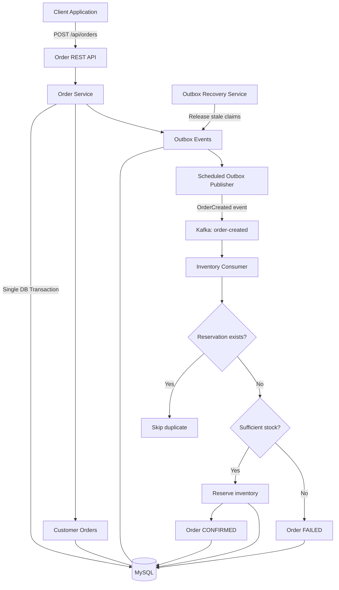

# AI Event-Driven Order Platform

A Java 21 and Spring Boot application demonstrating event-driven order processing, inventory reservation, Kafka messaging, and the Transactional Outbox pattern.

## Tech Stack

- Java 21
- Spring Boot 4.1.1
- Spring Data JPA / Hibernate
- MySQL
- Apache Kafka
- Maven
- JUnit 5 / Mockito
- Docker

## Architecture Diagram



## Key Features

- REST API for creating and retrieving orders
- Request validation and centralized exception handling
- Transactional Outbox pattern for reliable event publication
- Asynchronous event processing using Apache Kafka
- Atomic inventory stock updates
- Duplicate-event protection for inventory reservations
- Recovery of stale outbox processing claims
- Automated tests using JUnit and Mockito

## API Endpoints

### Create an Order

**Endpoint:** `POST /api/orders`

Example request:

```json
{
  "customerId": "CUST-1001",
  "productCode": "PROD-100",
  "quantity": 2,
  "amount": 499.00
}
```

Example cURL:

```bash
curl -X POST http://localhost:8080/api/orders \
  -H "Content-Type: application/json" \
  -d '{"customerId":"CUST-1001","productCode":"PROD-100","quantity":2,"amount":499.00}'
```

### Retrieve an Order

**Endpoint:** `GET /api/orders/{id}`

Example:

```bash
curl http://localhost:8080/api/orders/13
```

## Order Lifecycle

| Status | Description |
|---|---|
| `CREATED` | Order has been saved and awaits processing |
| `INVENTORY_RESERVED` | Inventory reservation has completed |
| `CONFIRMED` | Order has been successfully confirmed |
| `FAILED` | Inventory could not be reserved |

## Reliability and Design Decisions

### Transactional Outbox

The order and its `OrderCreated` event are persisted in the same database transaction. A scheduled publisher sends pending events to Kafka, avoiding the database-commit/Kafka-publish dual-write problem.

### Asynchronous Processing

Kafka decouples order creation from inventory processing, allowing the consumer to process events independently.

### Idempotent Inventory Reservation

The consumer checks for an existing reservation before reserving stock. This protects against duplicate event delivery.

### Atomic Stock Updates

Stock is decremented only when sufficient inventory is available, preventing stock from being over-reserved by concurrent requests.

### Outbox Recovery

Stale processing claims can be released so events can be retried after failures.

**Delivery guarantee:** Kafka processing is at-least-once, not exactly-once. Consumers must be idempotent.

## Run Tests

Run the test suite using Maven:

```bash
mvn test
```

**Latest verified result:** 12 tests passed, zero failures, and zero errors.

## Build and Run

### Prerequisites

- Java 21
- Maven
- Docker
- MySQL
- Apache Kafka

Ensure MySQL and Kafka are running and their connection details match `src/main/resources/application.properties`.

Build the application:

```bash
mvn clean package
```

Run the executable JAR:

```bash
java -jar target/ai-event-driven-order-platform-0.0.1-SNAPSHOT.jar
```

The application runs on port `8080` by default.

## Future Improvements

- Docker Compose for one-command local setup
- Integration tests with real MySQL and Kafka containers
- Retry topics and dead-letter handling
- Authentication and authorization
- Metrics, distributed tracing, and monitoring
- GitHub Actions CI pipeline

## Repository

[AI Event-Driven Order Platform on GitHub](https://github.com/GovindSharma22/ai-event-driven-order-platform)
